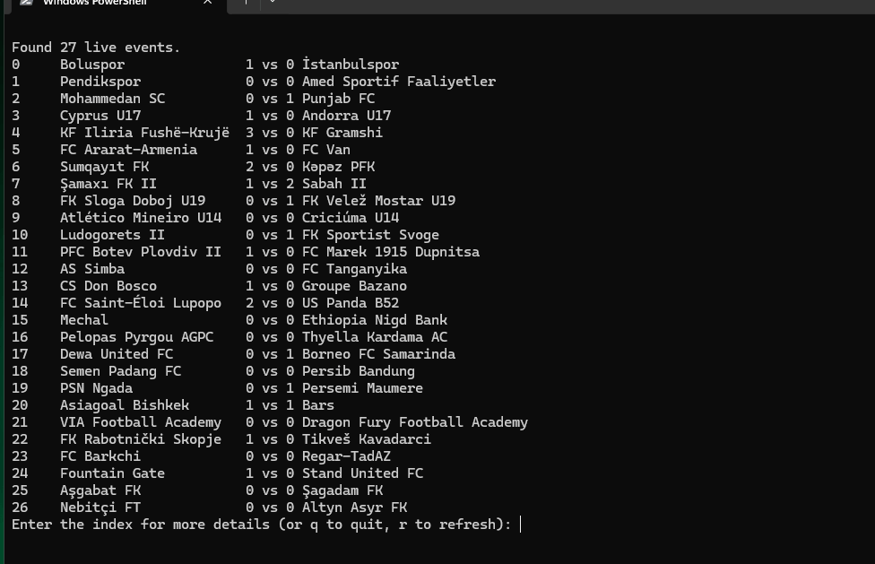

<h1 align="center">EasySoccerData</h1>

<p align="center">


</p>

<p align="center">
A simple python package for extracting real-time soccer/football data from diverse online sources, providing essential statistics and insights.
</p>


# Installation
```
pip install EasySoccerData
```

## Development
```
git clone https://github.com/manucabral/EasySoccerData.git
cd EasySoccerData
pip install -e .[dev]
```

# Usage

## Sofascore
```py
import esd

client = esd.SofascoreClient()
events = client.get_events(live=True)
for event in events:
    print(event)
```

[How to search for matches, teams, tournaments, and players](https://github.com/manucabral/EasySoccerData/blob/main/examples/sofascore/search_matchs.py)

[How to get tournament brackets](https://github.com/manucabral/EasySoccerData/blob/main/examples/sofascore/tournament_bracket.py)

[How to get live match statistics](https://github.com/manucabral/EasySoccerData/blob/main/examples/sofascore/get_live_matchs.py)


Check out [Sofascore module examples](https://github.com/manucabral/EasySoccerData/tree/main/examples/sofascore/)

## FBRef
```py
import esd

client = esd.FBrefClient()
matchs = client.get_matchs()
for match in matchs:
    print(match)
```

Check out [FBref module examples](https://github.com/manucabral/EasySoccerData/tree/main/examples/fbref/)

## Promiedos
```py
import esd

client = esd.PromiedosClient()
events = client.get_events()
for event in events:
    print(event)
```

Check out [Promiedos module examples](https://github.com/manucabral/EasySoccerData/tree/main/examples/promiedos/)

## Goaloo
```py
import esd

client = esd.GoalooClient()
league = client.get_league(36)          # 36 = English Premier League
standings = client.get_standings(36)
for row in standings[:5]:
    print(row.rank, row.team.name, row.points)
```

Check out [Goaloo module examples](https://github.com/manucabral/EasySoccerData/tree/main/examples/goaloo/)

## 365Scores
```py
import esd

client = esd.Scores365Client()
games = client.get_games("today")
standings = client.get_standings(72)    # 72 = Liga Profesional Argentina
for row in standings[0].rows[:5]:
    print(row.position, row.team.name, row.points)
```

Check out [365Scores module examples](https://github.com/manucabral/EasySoccerData/tree/main/examples/scores365/)

## Understat
```py
import esd

client = esd.UnderstatClient()
matches = client.get_league_matches("EPL", 2024)
shots = client.get_match_shots(26602)
```

Check out [Understat module examples](https://github.com/manucabral/EasySoccerData/tree/main/examples/understat/)

## Transfermarkt
```py
import esd

client = esd.TransfermarktClient()
player = client.get_player(28003)
print(player.name, player.market_value_display)
transfers = client.get_player_transfers(28003)
```

Check out [Transfermarkt module examples](https://github.com/manucabral/EasySoccerData/tree/main/examples/transfermarkt/)

## ESPN
```py
import esd

client = esd.ESPNClient()
matches = client.get_scoreboard("arg.1")
standings = client.get_standings("arg.1")
```

Check out [ESPN module examples](https://github.com/manucabral/EasySoccerData/tree/main/examples/espn/)

## BeSoccer
```py
import esd

client = esd.BeSoccerClient()
matches = client.get_matches("today")
standings = client.get_standings("torneo_final")
```

Check out [BeSoccer module examples](https://github.com/manucabral/EasySoccerData/tree/main/examples/besoccer/)

## Pandas

Install the optional dependency:

```sh
pip install "EasySoccerData[pandas]"
```

Convert match models into one row per match:

```py
import esd

client = esd.ESPNClient()
games = esd.to_dataframe(
    client.get_scoreboard("arg.1"),
    flatten=True,
    convert_dtypes=True,
    dtypes={"id": "string", "home_team.score": "Int64", "away_team.score": "Int64"},
    datetime_columns={"date": None},
)
if not games.empty:
    print(games[["id", "date", "home_team.name", "home_team.score"]])
```

`flatten=True` expands nested dictionaries into dot-separated columns. Lists stay
in cells. Without options, `to_dataframe()` keeps its original nested structure
and pandas type inference. `convert_dtypes=True` infers nullable scalar types;
use `dtypes` to fix column types even when all values are missing. Missing scores
remain missing and a score of zero remains zero. IDs such as `"001"` stay strings.

Dates are converted only for columns listed in `datetime_columns`. Use `None`
for strings or datetime objects, `"s"` for Unix seconds and `"ms"` for Unix
milliseconds. Output dates use UTC; naive dates are treated as UTC. Localize
source-local times before conversion. Invalid dates raise instead of becoming
missing values. Numeric timestamps are not interpreted automatically.

For standings, convert each table's rows rather than the table container:

```py
for table in client.get_standings("arg.1"):
    standings = esd.to_dataframe(table.rows, flatten=True, convert_dtypes=True)
    if not standings.empty:
        print(standings.sort_values("rank")[["rank", "team.name", "points"]])
```

| ESPN output column | Meaning | Type in the match example |
| :--- | :--- | :--- |
| `id` | Provider match identifier | `string` |
| `date` | Kickoff time | UTC datetime |
| `home_team.name` | Home team name | Nullable string |
| `home_team.score` | Home score, missing when unknown | `Int64` |
| `away_team.score` | Away score, missing when unknown | `Int64` |

Column names remain those of each provider's models. Empty input produces no
columns unless `dtypes` or `datetime_columns` declare a schema. Unknown columns
in nonempty input raise `KeyError`. Declare a date column in `datetime_columns`
only, without also including it in `dtypes`.

See the [offline match and standings example](examples/pandas/matches_and_standings.py)
for filtering columns, sorting standings and joining on team IDs.

## Common tables across providers

ESPN, 365Scores and Sofascore have opt-in adapters for matches, teams and standings.
Understat provides matches, teams, match xG/forecasts, player statistics and shots.
Existing clients still return their provider models. Adapters work without
pandas; only DataFrame export requires the pandas extra.

```py
import esd

client = esd.ESPNClient()
records = [
    esd.normalize_match(match, competition_id="arg.1", season=2026)
    for match in client.get_scoreboard("arg.1")
]
matches = esd.normalized_to_dataframe(records, table="matches")

scores = esd.Scores365Client()
other_records = [esd.normalize_match(game, season=2026) for game in scores.get_games()]
other_matches = esd.normalized_to_dataframe(other_records, table="matches")
```

Both outputs have the same columns and types, including when empty. Converting
models does not download a season or expand the scope of a client's query.
The `season` argument labels the records using the caller's query context.

| Table | Record model and adapter | Main fields |
| :--- | :--- | :--- |
| `matches` | `NormalizedMatch`, `normalize_match()` | `source`, `match_id`, `competition_id`, `season`, `source_season_id`, `stage_id`, `kickoff`, home/away team IDs, names and scores |
| `teams` | `NormalizedTeam`, `normalize_team()` | `source`, `team_id`, `name`, `short_name` |
| `standings` | `NormalizedStanding`, `normalize_standings(table)` | Source, competition/season, table/stage/group, team, rank, played/won/drawn/lost, goals, points and deductions |
| `match_stats` | `NormalizedMatchStats`, `normalize_match_stats()` | Source, match ID, home/away xG and win/draw/loss forecasts |
| `player_stats` | `NormalizedPlayerStats`, `normalize_player_stats()` | Source, competition/season, player ID, native team names, counts, xG and xA |
| `shots` | `NormalizedShot`, `normalize_shot()` | Source, shot/match/player IDs, minute, outcome, native X/Y and xG |

`normalized_to_dataframe(records, table=...)` exports schema version `1`:
identifiers and names use nullable `string`, counts use `Int64`, metrics use `Float64`, and `kickoff`
uses `datetime64[ns, UTC]`. The schema version and table name are also available
in `DataFrame.attrs`. Unknown table names or mismatched record models raise.

Keep these source differences in mind:

- IDs are provider-local strings. Join matches to teams using both `source`
  and the team ID. Adapters do not match entities across providers or merge
  similarly named teams.
- Supply `competition_id="arg.1"` for ESPN when the query context is known.
  365Scores already carries its native competition ID; conflicting overrides
  raise. ESPN table IDs describe groups, not competition IDs.
- `season` is an optional caller-supplied label such as `"2026"` or `"2025-26"`.
  365Scores' numeric season identifier stays in `source_season_id`; it is not
  interpreted as a calendar year. Stage and group identifiers remain separate.
- `source_status` and `source_status_text` retain each provider's values.
  They are not a shared status vocabulary. Provider scores are copied without
  asserting identical treatment of extra time or penalties.
- Kickoffs with an offset are converted to UTC. Missing dates remain missing.
  Invalid dates or dates without a timezone raise rather than assume a timezone.
  Understat's naive dates require an explicit `source_timezone` in the adapter
  or loader. Choose it from your knowledge of the source's date convention.
- Sofascore uses the unique tournament ID, separate from its regional tournament
  ID, and retains its native season ID. Pregame score defaults become null.
- Understat shot coordinates stay in `coordinate_system="understat-native"`.
  No pitch dimensions or direction conversion is assumed. Player season rows
  retain native `source_team_names`, which can contain several clubs.
- Unavailable fields remain null. The adapter cannot recover missing values
  already converted to defaults by a provider parser. 365Scores deductions are
  unavailable in the current model and stay null.

For standings, pass each provider table to `normalize_standings()` and export
the resulting rows with `table="standings"`. This preserves table, stage and
group context. Rankings and points are not recomputed.

See the [offline ESPN and 365Scores example](examples/pandas/normalized_tables.py).
FBref, Goaloo, Promiedos and BeSoccer also provide match adapters. Goaloo and
BeSoccer support standings-row adapters; Transfermarkt clubs support team adapters.
Unsupported model/table combinations raise `TypeError`. Original provider models
remain available for additional fields.

## Season datasets

Download an in-memory ESPN season snapshot with normalized matches and teams.
Add `standings` to fetch the source's standings snapshot for the same season:

```py
import esd

dataset = esd.load_dataset(
    source="espn",
    league="eng.1",
    season=2024,
    tables=["matches", "standings"],
    on_error="collect",
)
print(dataset.complete)
print(dataset.matches)
print(dataset.teams)
print(dataset.standings)
for issue in dataset.errors:
    print(issue.step, issue.target, issue.message)
```

The loader discovers ESPN's calendar and queries each day sequentially, with
a 0.25-second delay between requests and existing HTTP retries. Daily calendars
provide match dates; stage calendars expand to inclusive date ranges that can
include empty days. Repeated match IDs retain the last observed version. Teams
are derived from downloaded matches, deduplicated by source ID. Standings retain
their source table/group context and are not reconstructed for each matchday.

Use ESPN's season year: `2024` selects the 2024-25 English Premier League.
Season discovery uses July 1 by default; `anchor_date="2024-08-01"` selects
another lookup date. A mismatched source season raises rather than relabeling
the response. Multi-league `"all"` queries are not supported.

- `dataset.complete` means all tasks for the received calendar succeeded. It
  does not mean the season has finished or prove the source has every fixture.
- `dataset.metadata` records query parameters, schema version, UTC download
  timestamps, calendar type/dates and successfully downloaded dates.
- A failed or malformed day is recorded as a failure, not as an empty day.
  Its batch is not committed. Potentially truncated daily responses also fail.
- Default `on_error="raise"` stops with `esd.DatasetLoadError`; its `.dataset`
  contains partial results. `on_error="collect"` continues and returns
  `complete=False` with structured errors.
- `progress=callback` receives a `DatasetProgress` after discovery and each
  day/standings task, with completed/total tasks, success and match count.
  Exceptions in user callbacks propagate directly.
- `tables` defaults to matches, which also includes teams. Standings-only
  downloads are supported. Accessing an unrequested table raises `ValueError`.
- Records are available without pandas through `match_records`, `team_records`
  and `standing_records`. DataFrame properties require the optional pandas extra.

The loader writes no files unless you call `dataset.save()` separately.
Use `cache_dir` to persist responses and resume subsequent calls.
See the [season download example](examples/espn/season_dataset.py)
for progress reporting and inspection of partial results.

## Dataset providers

`esd.get_dataset_capabilities()` returns the implemented contracts for all nine
clients. All nine have a dataset loader, with different selection scopes and tables.

| `source` | Selection | Dataset tables |
| :--- | :--- | :--- |
| `espn` | League code and season year | Matches, teams, optional standings |
| `scores365` | Native competition ID and explicit UTC date range | Matches, teams, optional standings |
| `sofascore` | Unique tournament ID and native `season_id` | Matches, teams, optional standings |
| `understat` | League code and season year | Matches, teams, optional match statistics, player statistics and shots |
| `fbref` | Numeric competition ID and explicit dates | Matches, teams, optional match xG |
| `goaloo` | Numeric league ID and explicit native `source_season` | Matches, teams, optional standings |
| `promiedos` | Native league ID and explicit dates | Matches, teams |
| `besoccer` | Competition slug and explicit dates for matches; year for standings | Matches, teams, optional standings |
| `transfermarkt` | Explicit `club_ids` and/or `player_ids` | Teams, player profiles, valuation history, transfer history |

```py
scores = esd.load_dataset(
    source="scores365", league=7, season=2024,
    start_date="2024-08-16", end_date="2024-08-18",
    on_error="collect", cache_dir="./responses/365",
)
sofa = esd.load_dataset(
    source="sofascore", league=17, season=2024, season_id=61627,
    on_error="collect", cache_dir="./responses/sofa",
)
understat = esd.load_dataset(
    source="understat", league="EPL", season=2024,
    source_timezone="UTC",  # Use the source timezone you have verified.
    tables=["matches", "match_stats", "player_stats", "shots"],
    match_ids=[26602],  # Optional: otherwise shots for all completed matches.
    on_error="collect", cache_dir="./responses/understat",
)
```

365Scores is a date-range snapshot, not a full-season discovery API. `season`
is a caller label. Supply `season_id` to check native IDs in returned matches;
it is required for standings. Competition filtering also runs locally because
the API can ignore that filter. Missing game lists, mismatched dates and native
season IDs fail explicitly. Historical dates may be unavailable.

Sofascore downloads both past and upcoming pages. Each direction must reach an
explicit `hasNextPage=False`. Missing pagination, nonadvancing pages and the
`max_pages` limit produce partial errors. The year is a caller label; the native
ID selects the season. HTTP 403 remains a source block; no browser is launched.

Understat shots are opt-in. Selected IDs must belong to completed matches in
the queried league season. Metrics and coordinates retain source semantics.
AJAX responses can fall back to embedded data on the public page. A maintenance
page produces an error, not an empty dataset.

Goaloo requires `source_season="2024-2025"` (or the source's single-year form).
The start year must agree with `season`, and native league/season metadata is
validated. `source_timezone` is required for naive kickoff strings. Source
state codes are preserved; a score by itself does not establish final status.

FBref and Promiedos require explicit date bounds and interpret naive kickoff
dates using the caller's `source_timezone`. FBref uses sequential HTTP requests,
at least `60/9` seconds apart, without launching a browser. Unknown competition
IDs, missing match-report IDs and absent schedule tables fail explicitly.
Promiedos filters league IDs locally and preserves raw dates independently of
the computer's timezone. Its year is a caller label, not historical season selection.

BeSoccer pages can include adjacent-day games. The loader filters kickoffs to
the requested UTC day, or to `source_timezone` if supplied. A mismatched canonical
date page, browser challenge or missing listing fails explicitly. Standings-only
queries use the competition slug and year, without date bounds.

Transfermarkt exposes current profiles and full histories for selected entities.
It does not provide a match table or historical roster through this loader.
`league` and `season` record caller context. Clubs must match the native
competition ID; selected player profiles/histories are not filtered by league
or year. Native history dates remain strings, and monetary values retain their
source currency when available. Transfer fees preserve their source display
without inferring a currency not present in the model.

```py
goaloo = esd.load_dataset(
    source="goaloo", league=36, season=2024, source_season="2024-2025",
    source_timezone="Asia/Shanghai",  # Verify the source's date convention.
    tables=["matches", "standings"], on_error="collect",
)
profiles = esd.load_dataset(
    source="transfermarkt", league="GB1", season=2026,
    tables=["teams", "players", "market_values", "transfers"],
    club_ids=[281], player_ids=[418560], on_error="collect",
)
```

IANA timezone names require system timezone data or the `tzdata` package.
`source_timezone="UTC"` works with the standard library, but use it only when
the source timestamps actually use UTC.

For these providers, `metadata.expected_tasks` and `successful_tasks` describe
coverage. Pagination and shot discovery can increase progress totals.
`coverage_scope`, date bounds, native season ID, source timezone and requested
shot match IDs survive save/open. `complete` reports successful requested tasks,
not source exhaustiveness or a finished season. Inspect errors before analysis.
Records remain usable without pandas through `match_stat_records`,
`player_stat_records` and `shot_records`; their corresponding DataFrame
properties are `match_stats`, `player_stats` and `shots`.
Transfermarkt adds `player_records`, `market_value_records` and `transfer_records`,
with lazy `players`, `market_values` and `transfers` DataFrames. Its coverage scope
is `entities`; requested club/player IDs and Goaloo's source season survive snapshots.

See the [provider selection example](examples/datasets/providers.py).

## Check compatibility and link matches

Common columns do not establish that source IDs refer to the same club or league.
`check_dataset_compatibility(left, right)` checks schemas, shared tables, coverage,
source-local IDs and missing dates. Cross-source links require caller-supplied
competition and team equivalences:

```py
identities = esd.IdentityMap([
    esd.EntityAlias("competition", "my-league", "espn", "eng.1"),
    esd.EntityAlias("competition", "my-league", "understat", "EPL"),
    # Add each team's verified ESPN and Understat IDs under a common canonical ID.
])
report = esd.check_dataset_compatibility(left, right, identities=identities)
print(report.schema_compatible, report.identity_compatible, report.issues)
linked = esd.link_dataset_matches(left, right, identities=identities, tolerance_seconds=300)
print(linked.links, linked.unmatched_left, linked.ambiguous_left)
```

Linking requires the same mapped competition, ordered home/away identities and
kickoffs within the tolerance. Each side must have exactly one candidate.
Ambiguous games, unknown identities and rescheduled games outside the tolerance
remain unlinked. Names and scores never establish identity. Native IDs and input
records are preserved. Partial mappings can yield partial links; inspect both
unmatched and ambiguous IDs. There is no built-in catalogue of verified entity
equivalences. The programmer owns the mappings and can keep them outside the repo.
Source statuses, penalty conventions, xG models and pitch coordinates retain
their semantics even when a match is linked. These utilities require no pandas.

See the [offline linking example](examples/datasets/link_matches.py).

## Save and reopen datasets

The base installation requires neither pandas nor PyArrow. Install extras only
for the features you need:

```sh
pip install "EasySoccerData[pandas]"          # DataFrames
pip install "EasySoccerData[parquet]"         # Save/open snapshots, no pandas required
pip install "EasySoccerData[pandas,parquet]"  # Both
pip install "EasySoccerData[full]"            # All optional runtime features
```

Save a loaded dataset and reopen it without contacting the provider:

```py
path = dataset.save("./eng-2024-snapshot", format="parquet")
restored = esd.open_dataset(path)
print(restored.complete)
print(restored.metadata)
print(restored.errors)
print(restored.match_records)  # Available without pandas
# restored.matches returns a DataFrame when the pandas extra is installed.
```

Each snapshot directory contains `manifest.json` and one Parquet file for each
selected table (`matches.parquet`, `teams.parquet`, `standings.parquet`). The
manifest preserves query context, UTC download timestamps, calendar coverage,
partial-result errors, storage/schema versions, row counts and SHA-256 checksums.
Empty tables keep their schema. Source IDs, Unicode names, zero scores, missing
values and timezone-aware kickoffs survive reopening. Parquet kickoff timestamps
use UTC microseconds, matching Python datetime precision; DataFrame access keeps
the normalized UTC nanosecond dtype.

`save()` requires a new destination path and raises `FileExistsError` if it
already exists. Files are prepared in a temporary sibling directory and published
after all tables and the manifest are written. An ordinary write failure cleans
up the temporary directory without publishing a partial snapshot.

`open_dataset()` validates versions, filenames, checksums, row counts and table
schemas. Invalid or damaged snapshots raise `esd.DatasetFormatError`; a missing
directory raises `FileNotFoundError`. Opening preserves the dataset's coverage
and errors rather than marking a partial download as complete. It makes no
network requests. Saving/opening requires only the parquet extra; DataFrame
properties still require pandas separately.

See the [offline Parquet example](examples/datasets/parquet_roundtrip.py).
This release supports Parquet snapshots; overwriting and schema migrations are
not implemented yet. Persistent response caching is separate from snapshots.

## Resume and update downloads

Choose a response cache directory to reuse successful queries across runs and
processes. This feature requires no optional packages:

```py
dataset = esd.load_dataset(
    source="espn",
    league="eng.1",
    season=2024,
    cache_dir="./my-response-cache",
    on_error="collect",
)
```

Repeat the same call to resume an interrupted download. Each response is
persisted after validation. Fresh responses are reused, failed requests are
retried, and expired calendar responses discover newly published dates. The
dataset is rebuilt from those responses, so a day removed from a refreshed
calendar is not carried over from a previous in-memory result. Duplicate match
and team IDs use the newest response fetch timestamp; reading an older cached
response later does not replace a newer observation.

Default freshness policies, in seconds:

| Response | Freshness |
| :--- | ---: |
| Calendar | 300 |
| Today's matches | 30 |
| Upcoming dates | 300 |
| Past days with pending or unknown event states | 30 |
| Completed matches or empty days within the last 7 days | 3,600 |
| Older completed matches or empty days | 604,800 |
| Standings | 300 |

Override the policy or explicitly fetch everything again:

```py
policy = esd.CachePolicy(calendar_ttl=60, historical_ttl=86400)
dataset = esd.load_dataset(
    source="espn", league="eng.1", season=2024,
    cache_dir="./my-response-cache", cache_policy=policy,
    refresh=True,
)
```

`refresh=True` bypasses both response caches and writes replacements only after
successful source validation. Failed requests do not replace valid cached data.
Fresh cache hits incur no request delay. `DatasetProgress.cached` reports which
tasks used cached responses. Reusing a calendar is subject to its TTL: use
`refresh=True` or `calendar_ttl=0` to discover source changes immediately.
`dict(dataset.metadata.response_fetched_at)` exposes the original UTC fetch
timestamp per successful task, while `metadata.cached_tasks` identifies reused
responses. Both survive Parquet snapshots; reopening does not reset data age.

The programmer chooses both locations independently: `cache_dir` holds JSON
responses under `responses-v1`; `dataset.save(path)` creates a Parquet snapshot
at `path`. Without `cache_dir`, loading uses only the existing in-memory cache
and writes no files. The response cache stores neither URL keys nor proxy
credentials. Damaged or incompatible entries are treated as misses; permission
and disk errors raise `CacheError` (wrapped in `DatasetLoadError` during a strict
download, or recorded in a collected partial result).

Entries are replaced atomically. Disk entries are not automatically pruned;
call `esd.ResponseCache("./my-response-cache").clear()` to remove owned response
files. This leaves unrelated files alone. All nine dataset loaders support this
cache. Sofascore pages and Understat season responses use `calendar_ttl`;
Understat completed-match shots use `historical_ttl`. ESPN and 365Scores daily
responses use date/status freshness, and standings use `standings_ttl`.
Goaloo and the new dated match loaders cap freshness at `live_ttl`; Transfermarkt
profiles and histories use `calendar_ttl`. HTML responses are stored inside JSON
entries and validated before reuse.

See the [cache and resume example](examples/datasets/cached_season.py).

## Parallel fetching

Fetch multiple leagues or matches concurrently with `fetch_many`:

```py
from functools import partial

import esd
from esd.utils import fetch_many

client = esd.GoalooClient()
standings = fetch_many(
    [partial(client.get_standings, league) for league in (36, 31, 8)]
)
```

Requests use a pooled HTTP session, cache recent responses briefly, and retry transient failures automatically.

## Demo
Simple demonstration of a live table using Sofascore module (see [source code](https://github.com/manucabral/EasySoccerData/blob/main/examples/sofascore/live_table.py))
<p align="center">

</p>

# Documentation
For the full documentation, please visit the [Documentation Page](https://manucabral.github.io/EasySoccerData/esd.html)

If you have any questions or need further assistance, feel free to open an issue.

## Supported modules
| Name | PyPI version | Repository version |
| :--- | :---: | :---: |
| Sofascore | ✅ | ✅ |
| Promiedos | ✅ | ✅ |
| FBRef | ✅ | ✅ |
| Goaloo | ✅ | ✅ |
| 365Scores | ✅ | ✅ |
| Understat | ✅ | ✅ |
| Transfermarkt | ✅ | ✅ |
| ESPN | ✅ | ✅ |
| BeSoccer | ✅ | ✅ |

> Keep in mind that it is still under active development.

# Disclaimer
The data provided in this repository is gathered from various external sources and is intended solely for informational purposes. This software is distributed "as-is," without any warranties or guarantees. Users are solely responsible for ensuring that their use of this data complies with the terms of service of the respective data sources and all applicable laws.

The developers of this project assume no liability for any misuse, legal issues, or damages arising from the use of the data or software.


# Contributions
All contributions, bug reports, fixes, and ideas are welcome.

## Development checks

```sh
python -m pip install ".[dev,full]"
python -m ruff check esd tests scripts
python -m pytest
python -m build
```

The installation workflow checks the built wheel in isolated base, pandas,
parquet and full environments on Python 3.9–3.13, on Linux and Windows.
`scripts/check_install.py --extra base` verifies an installed distribution,
including optional dependency boundaries; it should run in the clean environment
being checked. Browser binaries and live provider access are not required.
