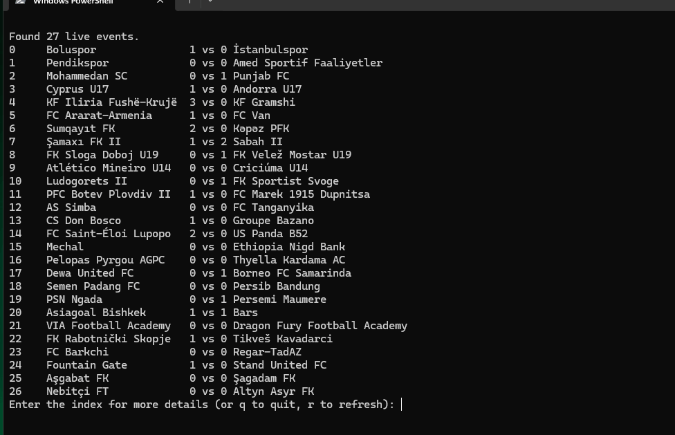

<h1 align="center">EasySoccerData</h1>

<p align="center">


</p>

<p align="center">
A Python library for football fixtures, live scores, standings and player statistics from nine providers.
</p>

# Installation

```sh
pip install EasySoccerData
```

Optional extras add DataFrame export and Parquet snapshots:

| Command | Added packages | Purpose |
| :--- | :--- | :--- |
| `pip install EasySoccerData` | `httpx`, `lxml`, `curl-cffi`, `playwright` | Provider clients, normalized record tuples, response cache, catalog, validation and comparisons |
| `pip install "EasySoccerData[pandas]"` | `pandas>=2.0` | DataFrame properties (`.matches`, `.standings`, `.player_match_stats`) and `esd.to_dataframe()` |
| `pip install "EasySoccerData[parquet]"` | `pyarrow>=17.0` | `dataset.save(...)` and `esd.open_dataset(...)` |
| `pip install "EasySoccerData[full]"` | `pandas>=2.0`, `pyarrow>=17.0` | All optional runtime dependencies |

When `use_playwright=True` is enabled on `SofascoreClient` or `FBrefClient`, Playwright launches the system's installed Google Chrome (`channel="chrome"`) or a custom binary via `chrome_path=...`, so running `playwright install chromium` is not required.

From a local checkout:

```sh
git clone https://github.com/manucabral/EasySoccerData.git
cd EasySoccerData
python -m pip install -e ".[dev,full]"
```

# Provider clients

## Sofascore
```py
import esd

client = esd.SofascoreClient()
events = client.get_events(live=True)
for event in events:
    print(event)
```

- [Search matches, teams, tournaments and players](https://github.com/manucabral/EasySoccerData/blob/main/examples/sofascore/search_matchs.py)
- [Tournament brackets](https://github.com/manucabral/EasySoccerData/blob/main/examples/sofascore/tournament_bracket.py)
- [Live match statistics](https://github.com/manucabral/EasySoccerData/blob/main/examples/sofascore/get_live_matchs.py)
- [All Sofascore examples](https://github.com/manucabral/EasySoccerData/tree/main/examples/sofascore/)

## FBref
```py
import esd

client = esd.FBrefClient()
matches = client.get_matchs()
for match in matches:
    print(match)
```

[FBref examples](https://github.com/manucabral/EasySoccerData/tree/main/examples/fbref/)

## Promiedos
```py
import esd

client = esd.PromiedosClient()
events = client.get_events()
for event in events:
    print(event)
```

[Promiedos examples](https://github.com/manucabral/EasySoccerData/tree/main/examples/promiedos/)

## Goaloo
```py
import esd

client = esd.GoalooClient()
league = client.get_league(36)          # 36 = English Premier League
standings = client.get_standings(36)
for row in standings[:5]:
    print(row.rank, row.team.name, row.points)
```

[Goaloo examples](https://github.com/manucabral/EasySoccerData/tree/main/examples/goaloo/)

## 365Scores
```py
import esd

client = esd.Scores365Client()
games = client.get_games("today")
standings = client.get_standings(72)    # 72 = Liga Profesional Argentina
for row in standings[0].rows[:5]:
    print(row.position, row.team.name, row.points)
```

[365Scores examples](https://github.com/manucabral/EasySoccerData/tree/main/examples/scores365/)

## Understat
```py
import esd

client = esd.UnderstatClient()
matches = client.get_league_matches("EPL", 2024)
shots = client.get_match_shots(26602)
```

[Understat examples](https://github.com/manucabral/EasySoccerData/tree/main/examples/understat/)

## Transfermarkt
```py
import esd

client = esd.TransfermarktClient()
player = client.get_player(28003)
print(player.name, player.market_value_display)
transfers = client.get_player_transfers(28003)
```

[Transfermarkt examples](https://github.com/manucabral/EasySoccerData/tree/main/examples/transfermarkt/)

## ESPN
```py
import esd

client = esd.ESPNClient()
matches = client.get_scoreboard("arg.1")
standings = client.get_standings("arg.1")
```

[ESPN examples](https://github.com/manucabral/EasySoccerData/tree/main/examples/espn/)

## BeSoccer
```py
import esd

client = esd.BeSoccerClient()
matches = client.get_matches("today")
standings = client.get_standings("torneo_final")
```

[BeSoccer examples](https://github.com/manucabral/EasySoccerData/tree/main/examples/besoccer/)

## Parallel requests and DataFrames

Run independent calls concurrently with `fetch_many` and convert client dataclasses to pandas DataFrames with `to_dataframe`:

```py
from functools import partial
import esd
from esd.utils import fetch_many

client = esd.ESPNClient()
eng_games, esp_games = fetch_many([
    partial(client.get_scoreboard, "eng.1"),
    partial(client.get_scoreboard, "esp.1"),
])

df = esd.to_dataframe(
    eng_games,
    flatten=True,
    convert_dtypes=True,
    dtypes={"id": "string", "home_team.score": "Int64", "away_team.score": "Int64"},
    datetime_columns={"date": None},
)
```

## Demo

[Live match table using Sofascore](https://github.com/manucabral/EasySoccerData/blob/main/examples/sofascore/live_table.py):

<p align="center">

</p>

# Normalized datasets

`esd.load_dataset` downloads normalized tables (`matches`, `teams`, `standings`, `match_stats`, `lineups`, `player_match_stats`, `match_events`, `shots`, `player_stats`, `players`, `market_values`, `transfers`) into an immutable `SoccerDataset`. Records are always available as tuples (`dataset.match_records`, `dataset.standing_records`, etc.) without optional dependencies; accessing `dataset.matches` or `dataset.standings` builds a typed pandas DataFrame on demand.

```py
import esd

catalog = esd.get_catalog()

# 1. Discover seasons and build load_dataset options
espn_seasons = catalog.list_seasons("uefa-champions-league", "espn", cache_dir="./cache")
espn_opts = catalog.dataset_options(
    "uefa-champions-league",
    next(s for s in espn_seasons.seasons if s.year == 2024),
)

# 2. Download match details, validate, and inspect coverage
espn_ds = esd.load_dataset(
    **espn_opts,
    tables=("matches", "teams", "match_stats", "lineups", "player_match_stats", "match_events", "shots"),
    match_ids=("704910",),
    cache_dir="./cache",
)
assert esd.validate_dataset(espn_ds).valid
coverage = esd.inspect_dataset_coverage(espn_ds, tables=("player_match_stats", "shots"))

# 3. Save a Parquet snapshot and reopen a filtered selection
espn_ds.save("./snapshots/ucl-espn")
subset = esd.open_dataset(
    "./snapshots/ucl-espn",
    tables=("player_match_stats", "match_stats"),
    match_ids=("704910",),
)

# 4. Calculate per-90 rates and pass/shot accuracy
derived = [esd.derive_statistics(row) for row in subset.player_match_stat_records]
derived_df = esd.derived_statistics_to_dataframe(derived)
```

Compare linked fixtures across providers using competition, team and player aliases:

```py
ucl = catalog.competition("uefa-champions-league")
sofascore_ds = esd.load_dataset(
    source="sofascore",
    league=ucl.for_source("sofascore").source_id,
    season=2024,
    season_id="61644",
    tables=("matches", "teams", "match_stats", "lineups", "player_match_stats", "match_events"),
    match_ids=("12173507",),
    cache_dir="./cache",
)

identities = catalog.identities().with_aliases([
    esd.EntityAlias("player", "ucl-p1", "espn", "301234", team_id="359"),
    esd.EntityAlias("player", "ucl-p1", "sofascore", "901234", team_id="42"),
])

stats_report = esd.compare_match_statistics(espn_ds, sofascore_ds, identities=identities)
events_report = esd.compare_match_events(
    espn_ds, sofascore_ds, identities=identities, allow_unknown_period=True
)
players_report = esd.compare_match_players(espn_ds, sofascore_ds, identities=identities)
```

See [`examples/datasets/champions_workflow.py`](examples/datasets/champions_workflow.py) for the complete offline and live Champions League CLI.

# Providers and limits

| `source` | Selection in `load_dataset` | Dataset tables | Main constraints |
| :--- | :--- | :--- | :--- |
| `espn` | `season` year (and optional `anchor_date`); `match_ids` for detail tables | `matches`, `teams`, `standings`, `match_stats`, `lineups`, `player_match_stats`, `match_events`, `shots` | `shots` contain only recognized descriptive summary attempts (`xg` and `xgot` are `None`). |
| `sofascore` | Native numeric `season_id`; `match_ids` for detail tables | `matches`, `teams`, `standings`, `match_stats`, `lineups`, `player_match_stats`, `match_events`, `shots` | `match_events` leave `source_period` as `None` (use `allow_unknown_period=True` in `compare_match_events`). |
| `scores365` | `start_date`/`end_date` for `matches`; native `season_id` for `standings` and detail tables | `matches`, `teams`, `standings`, `match_stats`, `lineups`, `player_match_stats`, `match_events` | No `shots` table. `player_id` uses game `member["id"]` (separate from `source_athlete_id`). |
| `understat` | `season` year; `source_timezone` for naive kickoffs; `match_ids` for `shots` | `matches`, `teams`, `match_stats`, `player_stats`, `shots` | Top 6 European leagues from 2014+. No `standings`, `lineups`, `player_match_stats` or `match_events`. |
| `fbref` | `start_date` and `end_date` for `matches`; `season` year for `standings` | `matches`, `teams`, `standings` | Enforces sequential rate limits (~3s per request) and can be blocked by Cloudflare challenges. |
| `goaloo` | Native `source_season` (e.g. `"2024-2025"`) and `source_timezone` | `matches`, `teams`, `standings` | No match-detail tables (`match_stats`, `lineups`, `player_match_stats`, `match_events`, `shots`). |
| `promiedos` | `start_date` and `end_date` for `matches`; `season` year for `standings` | `matches`, `teams`, `standings` | Date-page loader only; no historical season discovery index. |
| `besoccer` | `start_date` and `end_date` for `matches`; native standings year for `standings` | `matches`, `teams`, `standings` | Multi-year season option values may use the ending year (e.g. `2025` for `2024/25`). |
| `transfermarkt` | Explicit `club_ids` and/or `player_ids` | `teams`, `players`, `market_values`, `transfers` | `players` returns current profiles; `market_values` and `transfers` return full career histories. |

# Documentation

- [Published documentation](https://manucabral.github.io/EasySoccerData/)
- [Dataset guide](guides/datasets.md)
- [Examples index](examples/README.md)

# Data sources and license

EasySoccerData is independent of the data providers. Check each provider's terms before collecting or redistributing its data. Distributed under the [MIT license](LICENSE).

# Contributing

For bug reports, include the provider, method, arguments and traceback. Remove proxy credentials and tokens from logs. Add a response fixture and an offline regression test when submitting a parser fix.

## Development checks

```sh
python -m pip install ".[dev,full]"
python -m ruff check esd tests scripts examples
python -m pytest
python scripts/check_examples.py --extra full
python -m build
mkdocs build --strict -d ./site-docs
```
